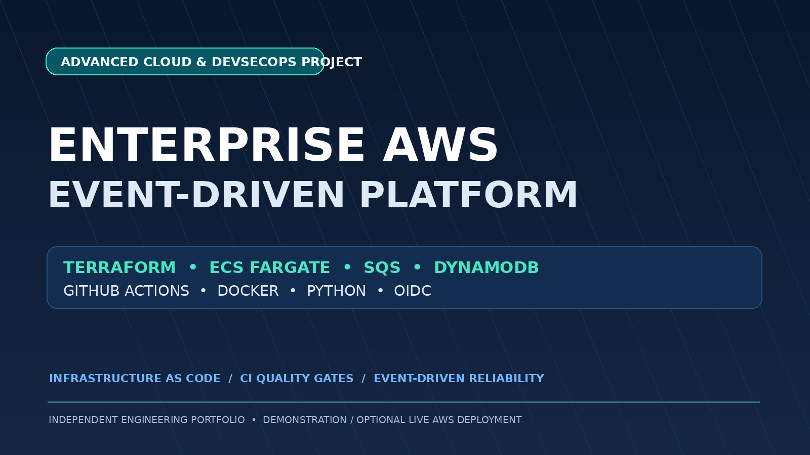
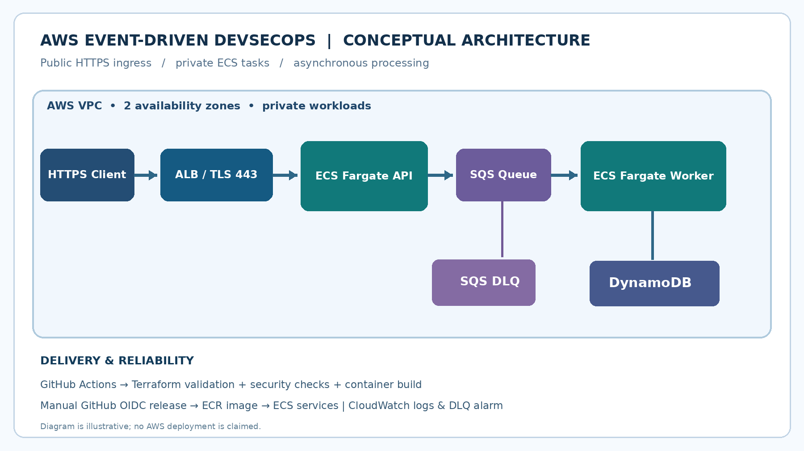
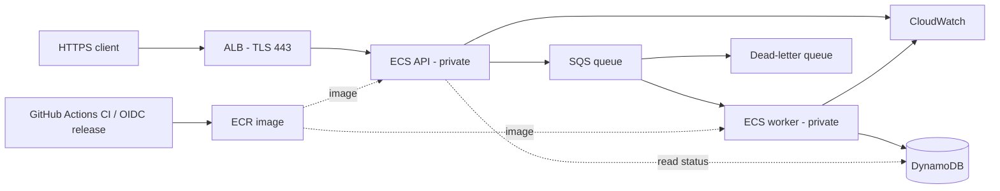

# Event-Driven AWS DevSecOps Platform

[](https://github.com/ftariq-tech/enterprise-aws-devsecops-platform/actions/workflows/ci.yml)

**Independent engineering portfolio project — FastAPI · Terraform · ECS Fargate · SQS · DynamoDB · GitHub Actions · Docker**

This project demonstrates how to design and validate an event-driven order-processing platform with cloud infrastructure as code, a containerized API and worker, least-privilege AWS permissions, idempotency, dead-letter handling, CI quality gates, and a tightly controlled optional cloud release process.

**Verified CI status:** GitHub Actions run for commit `5bf7119` on `main` passed all three jobs: `python-tests`, `terraform-validation`, and `container-build` (18 seconds, as shown in the workflow run). This verifies automated tests, static Python checks, Terraform initialization/validation, and a Docker image build. **No AWS infrastructure deployment or end-to-end live ECS/SQS/DynamoDB integration has been verified.**



## Architecture





Infrastructure defines one VPC, two public and two private subnets across availability zones, outbound NAT for private tasks, an HTTPS-only Application Load Balancer (opt-in), ECS API and worker tasks, an SQS queue with DLQ, a DynamoDB table, private IAM roles, CloudWatch logs/alarms, and an ECR registry. The demo uses **one NAT gateway**, which is not high availability; it incurs charges when deployed even with ECS runtime disabled.

## Engineering capabilities demonstrated in code

| Area | Implementation |
|---|---|
| API / application | FastAPI `POST /v1/orders` and `GET /v1/orders/{id}`; request validation, X-API-Key in AWS mode |
| Messaging | SQS asynchronous messages, retry visibility, DLQ after repeated failure |
| Idempotency | Stable request ID; conditional DynamoDB write; duplicate detection and conflicting payload handling |
| Infrastructure as Code | Terraform v6 AWS provider; VPC, subnets, ALB, ECS, ECR, IAM, SQS, DynamoDB, CloudWatch |
| Containerization | Docker image with non-root user and local Compose demonstration |
| CI security and quality | Python tests, Bandit scan, Terraform init/validate, Docker build |
| Release controls | Optional manual workflow dispatch, GitHub environment approval and AWS OIDC short-lived access |
| Reliability | ECS rollback circuit breaker, CloudWatch log groups, DLQ alarm (notification destination not configured) |

## Repository structure

```text
app/                   FastAPI API, Pydantic models, SQS worker and adapters
tests/                 Unit tests for validation, auth, idempotency and AWS adapters
infra/terraform/       AWS infrastructure, IAM, network and ECS configuration
.github/workflows/     CI validation workflow (release automation is planned separately)
scripts/               ECS release orchestration script
docs/                  Architecture, operations runbook, deployment guide and supporting notes
Dockerfile             Non-root container image
docker-compose.yml     Local-only API on 127.0.0.1:8000
SECURITY.md            Security assumptions and known gaps
```

## Run locally (no AWS account required)

Python 3.12+ recommended. From the repository root:

```bash
python -m venv .venv
# Linux/macOS: source .venv/bin/activate
# Windows PowerShell: .venv\Scripts\Activate.ps1
python -m pip install -r requirements-dev.txt
python -m pytest tests -v
uvicorn app.api:app --host 127.0.0.1 --port 8000
```

From a second terminal, submit synthetic order data (for local Python launch, `ORDERS_API_TOKEN` is unset by default):

```bash
curl -X POST http://127.0.0.1:8000/v1/orders \
  -H 'Content-Type: application/json' \
  -H 'Idempotency-Key: demo-order-key-0001' \
  -d '{"sku":"SKU-42","quantity":2}'
```

The local API uses an in-memory message queue; it **does not run an async background worker** or simulate real AWS delivery. The test suite calls the processing function explicitly using in-memory adapters. The demo's `GET` endpoint returns `PENDING_OR_UNKNOWN` until a worker writes to the repository. Docker Compose runs the same local API with a demonstration token:

```bash
docker compose up --build
# Include X-API-Key: local-demo-token-change-me in requests to the Compose API
```

## Continuous integration

[GitHub Actions workflow](.github/workflows/ci.yml) runs **only local verification** on push/PR: Python unit tests, Bandit medium/high static findings, Terraform formatting and validation, and container build. No AWS credentials are needed for CI. `terraform fmt -recursive` normalizes formatting in the runner; if it reformats files, commit its output to the repository in a subsequent change. A successful CI result **does not prove deployment works**. [View the GitHub Actions workflow](https://github.com/ftariq-tech/enterprise-aws-devsecops-platform/actions/workflows/ci.yml).

An optional `release.yml` workflow exists in the source project package but **has not been added to the public repository yet**. It should only be reviewed and added after configuring authorized AWS access, GitHub environment approvals, and a scoped OIDC role. Do not enable or trigger a release before reviewing [the deployment guide](docs/DEPLOYMENT_GUIDE.md), security controls, and cloud costs.

## Security and reliability notes

- HTTPS listener requires a verified ACM certificate. ECS tasks have no public IPs and run in private subnets. API is protected by a demo token, not a production identity system.
- API queue delivery is **at least once**; the worker uses a conditional DynamoDB write to avoid repeating the demo's database state change. This is **not** transactional exactly-once processing of external business effects.
- Worker only deletes SQS messages after a successful write or confirmed duplicate. Invalid messages are retried and eventually redriven to a DLQ.
- Task IAM roles have distinct API and worker permissions; GitHub release role can be restricted to a specific repo/environment with OIDC.
- ECR uses immutable image tags and scan-on-push. Application static security checks are not a substitute for a professional audit.
- AWS cost, production controls, WAF, multi-NAT HA, backup drills, distributed tracing, and a notification path for alerts remain design improvements.

## Optional AWS deployment and cost warning

Nothing is automatically deployed to AWS by cloning, opening, or running CI for this repository. **Do not casually run `terraform apply`: the default core infrastructure includes an hourly charged NAT Gateway and other billed services.** Set billing alerts, review the plan, and use only an authorized AWS account.

[Detailed deployment and cleanup guide](docs/DEPLOYMENT_GUIDE.md) · [Operations runbook](docs/OPERATIONS_RUNBOOK.md) · [Security scope](SECURITY.md)

---
*This is a self-directed educational/portfolio project, not paid client work or a certified production deployment.*
